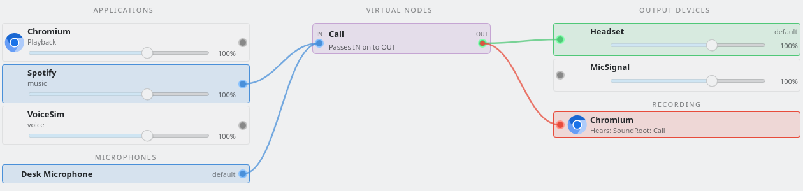

# Routing into applications

SoundRoot can route audio *into* an application that records: a Teams or
Discord call, a browser tab with a call in it, OBS, a voice recorder. This
document describes how to use that, how it is built, and its limits.

Status: implemented in the plasmoid. Covered by the recording cases of
`tests/tst_routingengine` and by `tst_audiogroup` and `tst_streambinder`.



## 1. What it does

The board has two more groups of cards:

- **MICROPHONES**, under APPLICATIONS on the left: the input devices.
- **RECORDING**, under OUTPUT DEVICES on the right: the applications that are
  recording right now. Each card shows what the application hears.

New wires:

| Wire | What happens |
|---|---|
| microphone → application under RECORDING | the application records that microphone |
| virtual node OUT → application under RECORDING | the application records everything played into the node |
| microphone → virtual node IN | the microphone plays into the node, like an application |

The main use: put music and your voice into one call.

```
Spotify ─────────┐
                 ├─► [ node "Call" ] OUT ─┬─► Teams (RECORDING)
Microphone ──────┘                        └─► Headset (you hear the music too)
```

## 2. Using it

1. Add a virtual node, e.g. "Call".
2. Wire the applications and the microphone you want in the call into its IN.
3. Wire its OUT to the call under RECORDING. Wire it to your headset too, if
   you want to hear what goes out.
4. Switch the room on.

An application shows up under RECORDING only while it records. A call that
has ended stays on the board greyed out ("Not recording"), with its wire. The
next call of that application gets the same wire again. You do not have to
start the call before you wire it.

An application records from one source, so it takes **one wire**. Dropping a
second wire on it replaces the first. To combine several sources, wire them
through a node.

Switching the room off puts every application it moved back on the default
microphone.

### Calls filter out music

Calls apply noise suppression, which treats music as noise and removes most
of it. Turn it off in the application while you send music:

- **Teams**: Settings → Devices → Noise suppression → Off. Some versions also
  have "High fidelity music mode".
- **Discord**: Settings → Voice & Video → Noise suppression → None (Krisp off).
- **Browsers** (Google Meet and others): the call's own audio settings.

### Picking the node by hand

Every virtual node also appears as a normal microphone, named
"SoundRoot: \<node name\>", while its room is on. It is listed in the
application's own device settings. If an application ever refuses to be
moved, pick that microphone there instead.

### Echo

If the node's OUT goes to speakers and your microphone is wired into the same
node, the microphone picks up the speakers and the other side hears an echo.
Use a headset.

## 3. How it is built

PulseAudio and PipeWire have two halves:

| | Playback | Recording |
|---|---|---|
| Device | sink | source |
| Application stream | sink-input | source-output |
| Move a stream | `move_sink_input` | `move_source_output` |

SoundRoot handled only the playback half before. The recording half works the
same way:

- **Node microphone.** Each virtual node is a null-sink. Its monitor carries
  what is played into it. Chromium-based applications (Teams, Discord, every
  browser call) do not offer monitors as microphones at all. So SoundRoot loads
  a `module-remap-source` over the monitor, named `<node>_mic` with the
  description "SoundRoot: \<name\>". To an application, that is an ordinary
  microphone.
- **Microphone into a node.** A `module-loopback` from the microphone into the
  null-sink, with `latency_msec=20` so a voice does not lag. Both sides use
  `*_dont_move`: an unplugged microphone ends the loopback instead of
  recording another one. The engine loads it again when the microphone
  returns.
- **Moving the application.** The routing engine moves the source-output with
  `move_source_output`, in the same reconcile pass that moves playback
  streams. A recording application is matched to its saved wire by
  application name and ordinal (`StreamBinder`), because every call opens a
  new stream with a new index. The guard against a server that keeps moving a
  stream back applies here too.

Which source-outputs are listed under RECORDING: everything except

- streams owned by a module (`owner_module` set, or no client): the node
  microphones, the loopbacks, and the same kind of thing loaded by others;
- peak meters of volume applets and pavucontrol. PipeWire marks them with the
  property `stream.monitor` (also `resample.peaks`). PulseAudio reports the
  resampler `peaks`;
- SoundRoot's own network capture (`media.name` starting with
  `soundroot_netcap_`).

Saved in `groups.json`, per room:

```json
"captures": [ { "app": "Teams for Linux\t0", "media": "RecordStream",
                "source": "soundroot_virt_1a2b3c4d_mic" } ],
"virtualSinks": [ { "paName": "soundroot_virt_1a2b3c4d",
                    "inputSources": ["alsa_input.usb-…"], … } ]
```

Both keys are written only when they are used. A room without them has
exactly the format older versions read.

### WirePlumber remembers the move

WirePlumber stores the device an application was last moved to, per
application. The next call of that application starts on the same source
before SoundRoot does anything. While the room is on, that is what we want.
When the room is switched off, SoundRoot moves the application back to the
default microphone, which also replaces the stored device.

## 4. Limits

- **A network node's OUT cannot go to a recording application.** Received
  audio is played by a playback stream, not through the node's monitor.
  Planned.
- **A microphone cannot go straight to an output device** (hearing yourself).
  Planned.
- **No volume or mute** on microphone and recorder cards yet.
- **Native PulseAudio** (without PipeWire) has not been tested. The modules
  used exist there, and the filters cover its way of marking peak meters.
- **Renaming a node** while its room is on keeps the old name on its
  microphone until the room is switched off and on.

## 5. Tests

`tst_routingengine` runs the engine against an in-memory sound server. Its
cases cover:

- each kind of wire;
- a second wire that replaces the first;
- a call that ends and a new one that is routed the same way;
- switching off and on;
- a microphone that is unplugged and plugged back in;
- the wires that are refused;
- removing nodes and microphones;
- a restart from the saved file;
- a server that keeps moving the stream back.

The board was also tested by hand in a private PipeWire:

- **Setup:** a null-sink with a 440 Hz tone at 0.2 standing in for the voice,
  a 880 Hz tone at 0.6 for the music, headless Chromium recording through
  `getUserMedia`, and the plasmoid in `plasmawindowed` on Xvfb.
- **Room on:** the page heard both tones (peak ≈ 0.78).
- **Room off:** only the microphone (0.2).
- **Wire dragged from the microphone onto Chromium:** it replaced the node's
  wire, and the page heard only the microphone.
